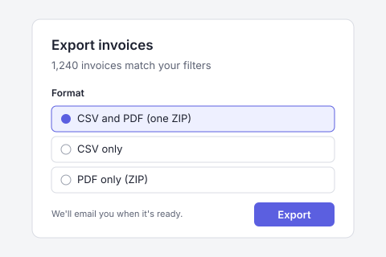

# Bulk invoice export

## Table of Contents

- [1. Problem Statement](#1-problem-statement)
- [2. Background & Context](#2-background--context)
  - [2.1 References](#21-references)
  - [2.2 Key Constraints](#22-key-constraints)
  - [2.3 Key Concepts](#23-key-concepts)
  - [2.4 Out of Scope](#24-out-of-scope)
- [3. Requirements](#3-requirements)
  - [3.1 Selecting Invoices](#31-selecting-invoices)
  - [3.2 Export Formats](#32-export-formats)
  - [3.3 Delivery](#33-delivery)
  - [3.4 API](#34-api)
- [4. Open Questions](#4-open-questions)
- [5. Non-Functional Requirements](#5-non-functional-requirements)

## 1. Problem Statement

Finance admins close their books every month by pulling invoices out of our
product and into their ERP. Today they can only download invoices one at a
time, so a team with 600 monthly invoices spends most of a day clicking
"Download PDF".

The existing "Export list" button only exports the visible table columns, not
line items, tax breakdowns, or payment status, so admins re-key data by hand.
Support also handles about 90 tickets a month asking for "all invoices for
last month", which agents fulfil with a manual database script.

We want finance admins to filter the Invoices list, choose a format, and get
one download: a CSV of invoice and line-item data, a ZIP of invoice PDFs, or
both. Success means an admin can export a month of invoices in under 5 minutes
of their own time, and the manual support workflow goes away.

## 2. Background & Context

Bulk export is the top-voted request on the feedback board (412 votes) and
was named as a churn reason in 6 of the last 20 lost-account interviews.

### 2.1 References

1. [Interview notes](interview-notes.md): 8 finance admin interviews, 2026-09-29 to 2026-10-10
2. [API contract](api-contract.md): endpoints, job states, and CSV columns
3. [Export dialog wireframe](assets/export-dialog.svg)

### 2.2 Key Constraints

1. ERP importers are strict about CSV columns, so the column list in [[3.2.2]] is a versioned contract. Changing it later breaks customers' saved import mappings.
2. PDFs must come from the existing invoice renderer, so they match the single-invoice download exactly.
3. Single-invoice downloads share that renderer, so bulk exports must not slow them down. See [[5.1]].

### 2.3 Key Concepts

1. **Export job:** a background task that builds one export file. States are `queued`, `running`, `completed`, `failed`, and `expired`.
2. **Direct download:** an export small enough to build while the dialog is open, with no job. See [[3.3.1]].
3. **Line-item row:** one CSV row per invoice line, with the invoice header fields repeated on each row.

### 2.4 Out of Scope

1. XLSX or other spreadsheet formats. CSV opens in every spreadsheet tool and is what ERP importers expect.
2. Direct sync to ERPs (NetSuite, QuickBooks, Xero). That belongs to a separate integrations spec.
3. **Test**
4. Scheduled or recurring exports. Admins start each export by hand. See [[4.2]].
5. Credit notes and quotes. Invoices only.

## 3. Requirements

### 3.1 Selecting Invoices

As a finance admin, I want to export every invoice that matches my filters
so that I can pull a whole month, or only unpaid invoices, in one go.

1. The Invoices list gets an "Export" action that exports every invoice matching the current filters, not only the visible page.
   1. Supported filters are the existing ones: date range, status, customer, currency.
   2. The dialog shows the matching invoice count before the admin confirms.
   3. Admins can also select individual rows and export only the selection.

### 3.2 Export Formats

As a finance admin, I want to choose the file format so that I can import
invoice data into our ERP or hand a ZIP of PDFs to our auditors.

1. The admin chooses one of three formats: CSV, PDF (ZIP), or CSV and PDF together (one ZIP).
2. The CSV has one line-item row per invoice line. Columns are listed in the [API contract](api-contract.md#csv-columns).
   1. Amounts use a dot decimal separator and no thousands separator, whatever the account locale.
   2. Files are UTF-8 with a byte order mark so Excel opens accented customer names correctly.
3. PDFs in the ZIP are named `<invoice-number>_<customer-name>.pdf`, in one flat folder (see [[4.3]]).

### 3.3 Delivery

As a finance admin, I want large exports to finish in the background so that
I don't have to keep the page open.

1. Exports of up to 200 invoices download directly from the dialog. Larger exports run as an export job, and the admin is notified in-app and by email with a link when it is ready.
2. Download links expire after 7 days. An "Exports" panel lists the admin's last 10 exports with their status.
3. If a job fails, the Exports panel shows "Failed" with a Retry button, and the email says the same.

### 3.4 API

As a developer at a customer, I want to start and download exports through
the API so that I can automate month-end close.

1. `POST /v1/invoice-exports` takes the filters and format and returns an export job. Contract: [POST /v1/invoice-exports](api-contract.md#post-v1invoice-exports).
2. `GET /v1/invoice-exports/{id}` returns job status and, when complete, a signed download URL.
3. An `invoice_export.completed` webhook fires when a job completes or fails, with the same payload as [[3.4.2]].

## 4. Open Questions

1. Should the CSV include a separate payments file, or keep payment status as columns on each row? _(owner: Priya, due: 2026-11-07)_
2. How many design partners want scheduled exports enough to pull [[2.4.4]] into scope? _(owner: Austin, due: 2026-11-14)_
3. Should PDFs in the ZIP be grouped into folders by customer? _(owner: Marcus, status: resolved)_
   1. Answer: No, keep one flat folder. Auditors in interviews preferred sorting by file name. Decided 2026-10-22.

## 5. Non-Functional Requirements

1. Export jobs run on a separate worker pool, so single-invoice download latency does not change (p95 within 5% of today).
2. A 5,000-invoice CSV-and-PDF export completes in under 10 minutes at p95.
3. A single export is capped at 10,000 invoices. Above the cap, the dialog asks the admin to narrow the filters.
4. Only users with the `billing.export` permission can export. Every export is written to the audit log with the user, filters, format, and invoice count.
5. Export files are stored encrypted and deleted when the link expires ([[3.3.2]]).
